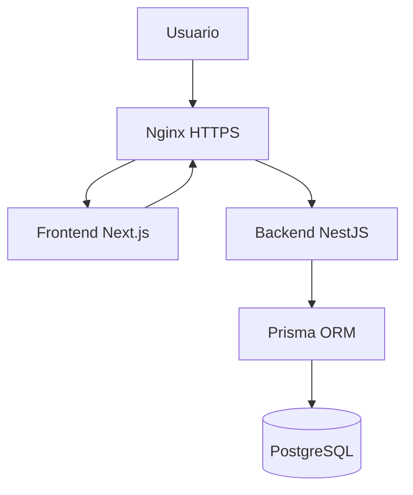

# 02. Arquitectura del sistema

## Descripción general
Núcleo Digital es un sistema web para administrar operaciones de restaurantes.

## Tecnologías
- Frontend: Next.js 16, React 19, TypeScript y Tailwind CSS 4.
- Backend: NestJS 12 y Prisma 7.
- Base de datos: PostgreSQL 18.
- Autenticación: JWT y bcrypt.
- Infraestructura: AWS EC2, Docker, Nginx y HTTPS.

## Arquitectura
El navegador se conecta mediante HTTPS a Nginx, que dirige las solicitudes al frontend Next.js y a la API NestJS. La API utiliza Prisma para acceder a PostgreSQL.

## Diagrama de arquitectura

## Módulos principales
- Autenticación y usuarios.
- Menú y platillos.
- Pedidos, cocina y mesas.
- Reservas e inventario.
- Pagos y comprobantes.
- Programa de lealtad.
- Notificaciones y reseñas.
- Reportes.

## Enlaces públicos
- Aplicación: https://18.218.151.130.sslip.io/login
- Swagger: https://18.218.151.130.sslip.io/api/docs
