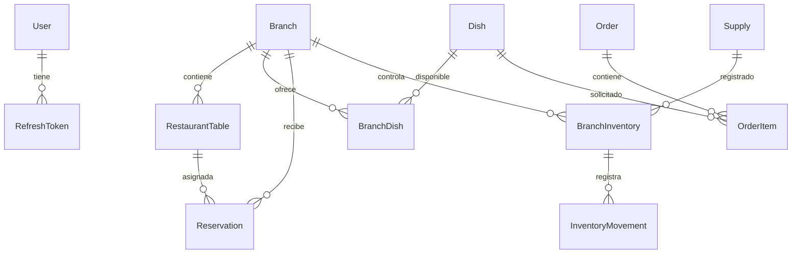

# 03. Modelo de datos

## Descripción
La aplicación utiliza PostgreSQL 18 y Prisma 7.
El esquema contiene 27 modelos para gestionar las operaciones del restaurante.

## Diagrama entidad-relación

## Entidades principales
- User: usuarios y roles del sistema.
- Branch: sucursales del restaurante.
- Dish y Category: platillos y categorías.
- RestaurantTable: mesas del restaurante.
- Reservation: reservas de clientes.
- Order y OrderItem: pedidos y sus detalles.
- Payment y Receipt: pagos y comprobantes.
- Supply y BranchInventory: insumos y existencias.
- LoyaltyAccount: cuentas del programa de puntos.
- Notification: notificaciones del sistema.
- Review: reseñas de clientes.

## Migraciones
El esquema de la base de datos se administra mediante migraciones de Prisma.
